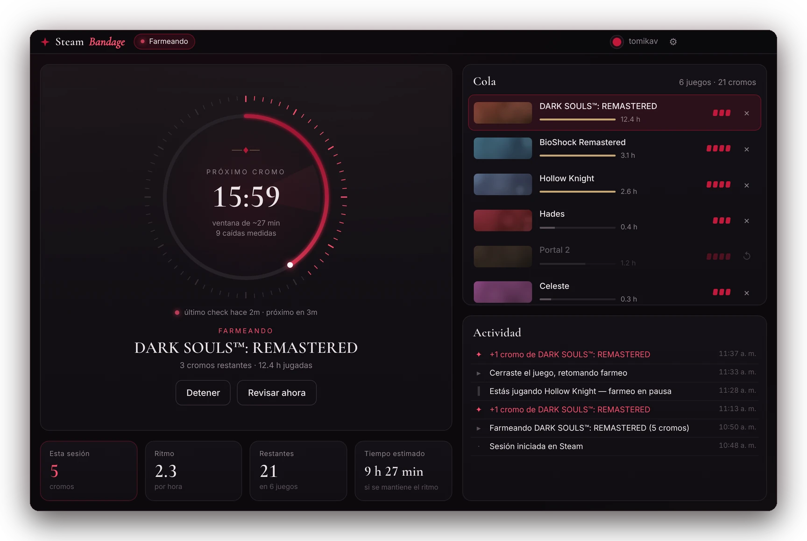
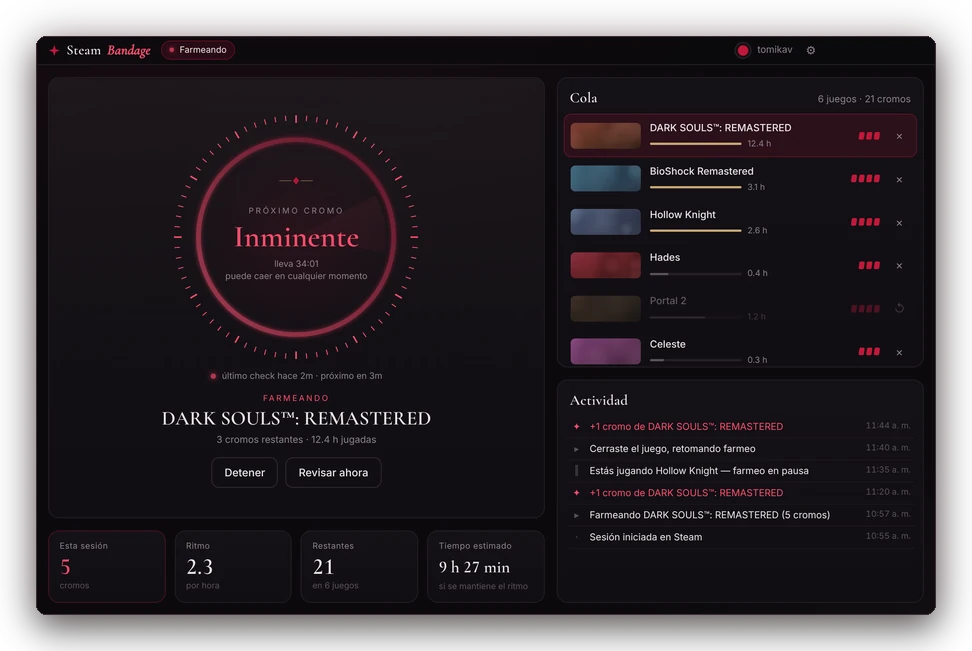
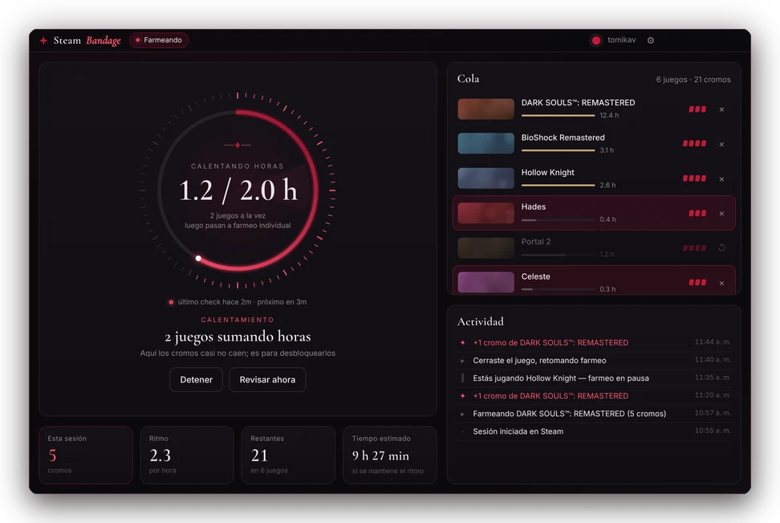
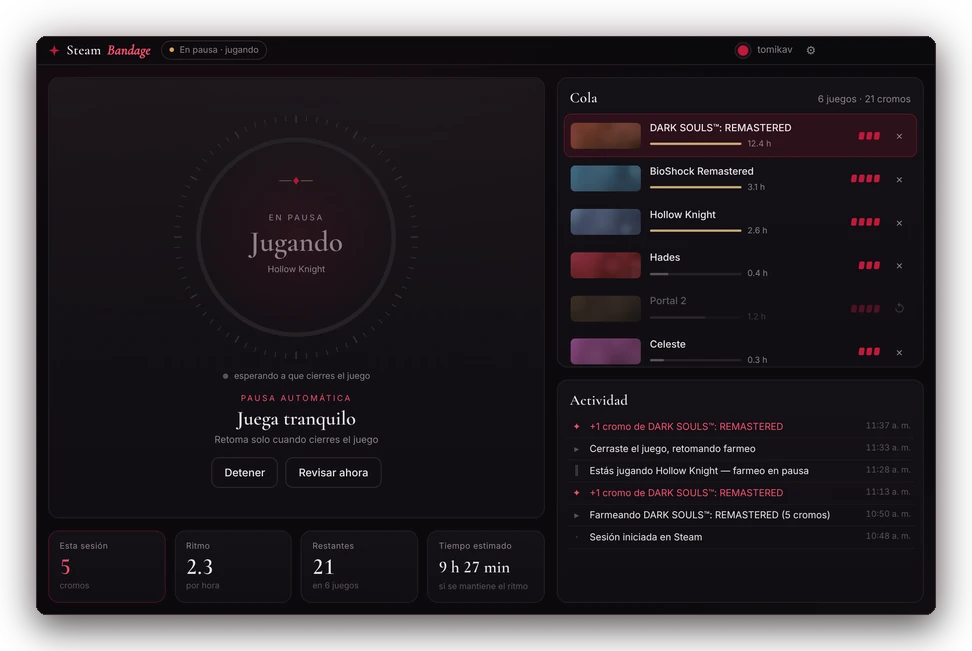
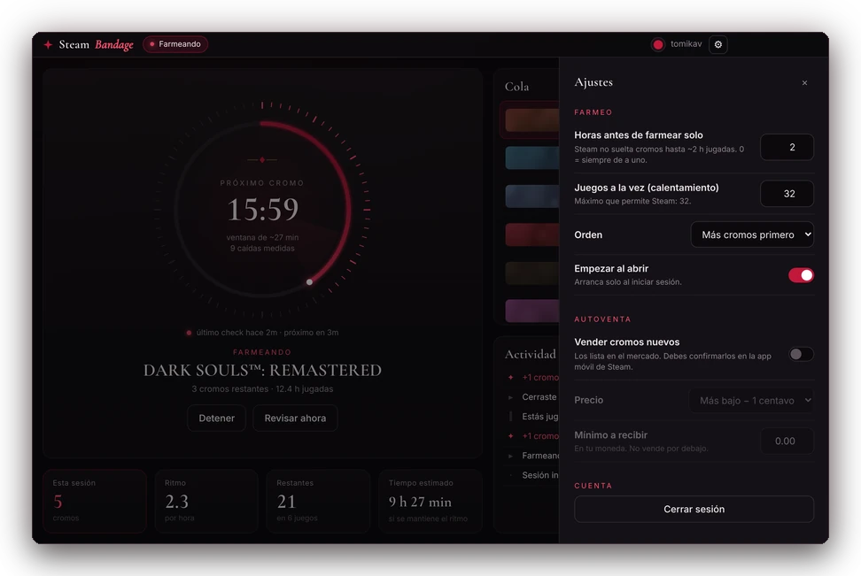
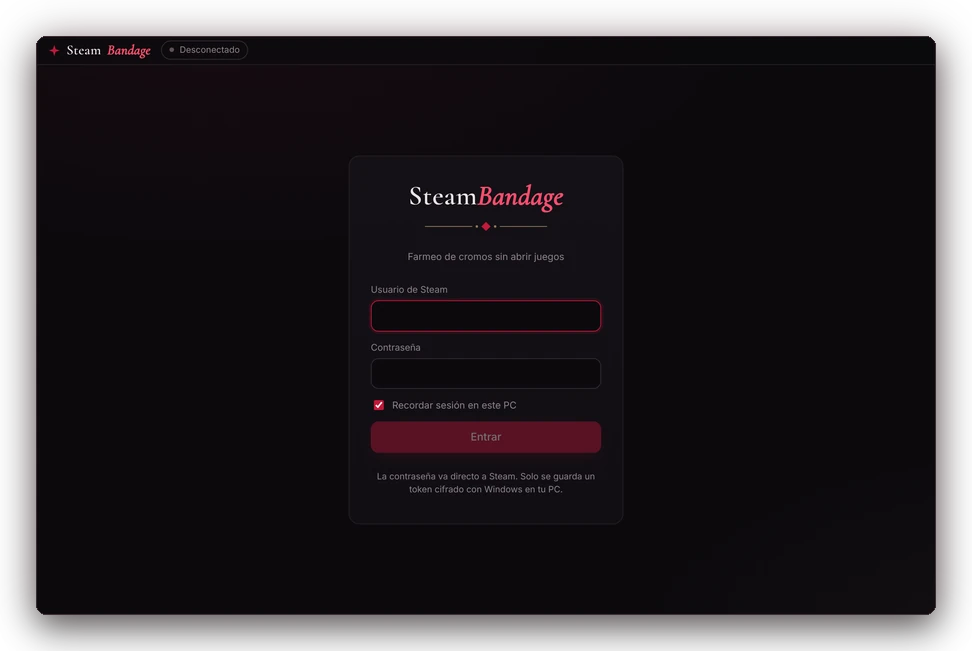
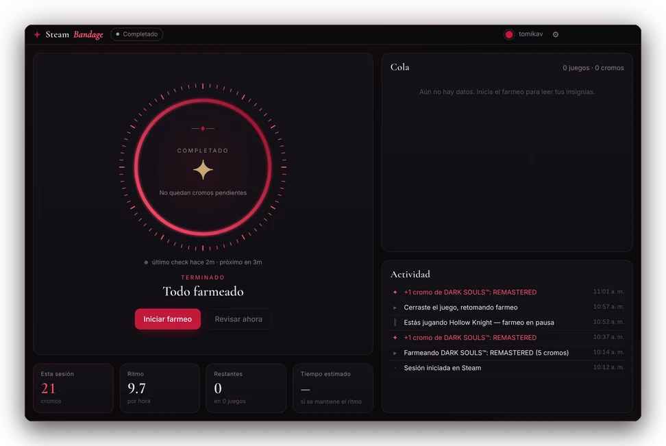
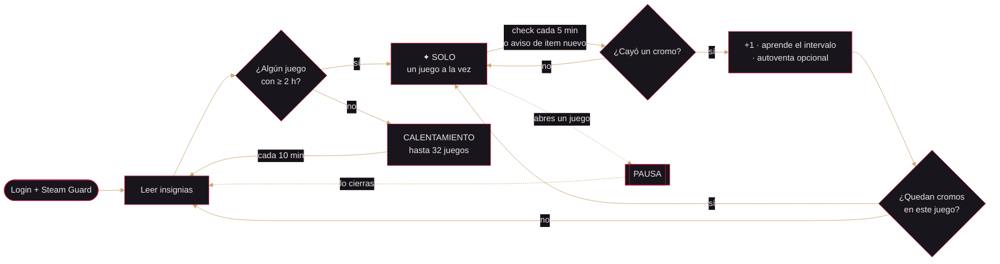

<p align="center">
  
</p>

<p align="center">
  
  
  
  
  
</p>

<p align="center">
  <a href="#-instalación"><b>Instalación</b></a> &nbsp;✦&nbsp;
  <a href="#-cómo-funciona"><b>Cómo funciona</b></a> &nbsp;✦&nbsp;
  <a href="#-capturas"><b>Capturas</b></a> &nbsp;✦&nbsp;
  <a href="#-ajustes"><b>Ajustes</b></a> &nbsp;✦&nbsp;
  <a href="#-preguntas"><b>Preguntas</b></a>
</p>

<br>

<p align="center">
  
</p>

<p align="center"></p>

<h3 align="center"><i>Un farmeador de cromos que no desperdicia ni un minuto.</i></h3>

<p align="center">
SteamBandage inicia sesión como un cliente de Steam aparte y le dice a Steam que estás jugando, <b>sin abrir ningún juego</b>.<br>
No consume CPU ni GPU, sigue cuántos cromos le quedan a cada juego y pasa al siguiente en cuanto se acaban.<br>
Si abres un juego, se pausa solo. Cuando lo cierras, retoma.
</p>

<br>

<table>
<tr>
<td width="33%" valign="top">

### ✦ Indicador de drop
Un anillo con la cuenta regresiva estimada hasta el próximo cromo. **Aprende de tu cuenta**: usa la mediana de los intervalos reales que va midiendo.

</td>
<td width="33%" valign="top">

### ✦ Algoritmo de 2 fases
Farmea de uno en uno los juegos que ya sueltan cromos y pone a sumar horas, hasta 32 a la vez, a los que todavía no.

</td>
<td width="33%" valign="top">

### ✦ Juega tranquilo
Cuando Steam detecta que estás jugando en tu PC, se pausa automáticamente. Al cerrar el juego retoma sin que hagas nada.

</td>
</tr>
<tr>
<td width="33%" valign="top">

### ✦ Autoventa opcional
Lista los cromos nuevos en el mercado al precio más bajo o un centavo por debajo. **Viene apagada.**

</td>
<td width="33%" valign="top">

### ✦ Cero recursos
No lanza procesos falsos de juegos. Solo una conexión ligera con Steam, y se queda en la bandeja del sistema.

</td>
<td width="33%" valign="top">

### ✦ Sesión segura
La contraseña va directo a Steam. Solo se guarda un token cifrado con Windows (DPAPI).

</td>
</tr>
</table>

<p align="center"></p>

## ✦ Capturas

<table>
<tr>
<td align="center" width="50%"><br><sub><b>Inminente</b> · ya pasó la ventana estimada, puede caer en cualquier momento</sub></td>
<td align="center" width="50%"><br><sub><b>Calentamiento</b> · varios juegos sumando horas a la vez</sub></td>
</tr>
<tr>
<td align="center"><br><sub><b>Pausa automática</b> · estás jugando, retoma solo al cerrar</sub></td>
<td align="center"><br><sub><b>Ajustes</b> · umbral de horas, orden, autoventa</sub></td>
</tr>
<tr>
<td align="center"><br><sub><b>Login</b> · con soporte para Steam Guard</sub></td>
<td align="center"><br><sub><b>Completado</b> · no quedan cromos pendientes</sub></td>
</tr>
</table>

<p align="center"></p>

## ✦ Cómo funciona



> [!NOTE]
> **Sobre la velocidad:** Steam decide en sus servidores cuándo cae cada cromo, más o menos uno cada 20-30 minutos de juego y solo de un juego a la vez. **Ningún programa puede hacer que caigan más rápido.** Lo que hace SteamBandage es no perder tiempo: nunca deja un juego sin cromos ocupando el turno, nunca farmea en solo un juego que todavía no suelta cromos, y retoma en cuanto puede. En la práctica son unos **2-3 cromos por hora**.

<details>
<summary><b>¿Cómo se calcula la cuenta regresiva del anillo?</b></summary>
<br>

Steam no expone cuánto falta para el próximo cromo. SteamBandage mide cuánto tardó cada cromo real en tu cuenta y usa la **mediana de los últimos 15**, descartando valores absurdos. Arranca con 30 minutos y se va afinando solo. Cuando se pasa del tiempo esperado, el anillo pulsa en rojo con **Inminente**.

- **Barrido giratorio:** la sesión con Steam está viva.
- **Pulso:** se está consultando a Steam en ese momento.
- **Ticks encendidos:** progreso dentro de la ventana estimada.

</details>

<p align="center"></p>

## ✦ Instalación

> [!IMPORTANT]
> Necesitas **Node.js 20 o superior** y **Windows 10/11**.

```powershell
git clone https://github.com/tomikav/steambandage.git
cd steambandage
npm install
npm run dev
```

**Generar el instalador `.exe`:**

```powershell
npm run dist
```

El instalador queda en `release/`.

| Comando | Qué hace |
|:--|:--|
| `npm run dev` | Abre la app en modo desarrollo con recarga en caliente |
| `npm run build` | Compila la interfaz en `dist/` |
| `npm start` | Abre la app con la interfaz ya compilada |
| `npm test` | Simula Steam completo y prueba el algoritmo |
| `npm run dist` | Genera el instalador de Windows |

<p align="center"></p>

## ✦ Ajustes

| Ajuste | Por defecto | Descripción |
|:--|:--:|:--|
| Horas antes de farmear solo | `2` | Horas mínimas para que Steam suelte cromos. `0` = siempre de a uno |
| Juegos a la vez | `32` | Cuántos juegos se calientan juntos (máximo de Steam) |
| Orden | Más cromos | `Más cromos` · `Más horas` · `Alfabético` |
| Empezar al abrir | ✓ | Arranca solo al iniciar sesión |
| Vender cromos nuevos | ✗ | Autoventa al mercado. **Requiere confirmar en la app móvil** |
| Precio | Más bajo − 1 centavo | O igual al precio más bajo |
| Mínimo a recibir | `0.00` | No lista por debajo de esto |

Para saltar un juego, usa la **×** en la cola. Con **↺** lo vuelves a incluir.

<p align="center"></p>

## ✦ Estructura

```
steambandage/
├── electron/
│   ├── main.js            ventana, bandeja, IPC, notificaciones
│   ├── preload.js         API segura para la UI (contextIsolation)
│   ├── store.js           ajustes, estadísticas y token cifrado
│   └── steam/
│       ├── farmer.js      núcleo: login, algoritmo, pausas, drops
│       ├── badges.js      lee insignias y cromos restantes
│       └── market.js      autoventa y cálculo de comisiones
├── src/                   interfaz en React
│   ├── App.jsx
│   ├── components/        DropRing · Queue · Activity · Settings · Login
│   └── styles.css         tema vamp
├── test/                  simulación completa de Steam
└── docs/                  banner, capturas, ornamentos
```

<p align="center"></p>

## ✦ Preguntas

<details>
<summary><b>¿Me pueden banear por usar esto?</b></summary>
<br>
Farmear cromos con idlers lleva años siendo tolerado por Steam (ArchiSteamFarm, Idle Master, etc.) y no afecta VAC, porque no se toca ningún juego. Aun así, es una herramienta no oficial: úsala bajo tu propio criterio.
</details>

<details>
<summary><b>¿Puedo jugar mientras farmeo?</b></summary>
<br>
Sí. Steam solo permite una sesión jugando por cuenta. Cuando abres un juego, Steam te avisa que la cuenta está en uso en otro equipo. Le das a <b>continuar</b> y SteamBandage se pausa solo. Al cerrar el juego, retoma.
</details>

<details>
<summary><b>¿Por qué no caen cromos en el calentamiento?</b></summary>
<br>
En muchas cuentas Steam no suelta cromos hasta que el juego tiene unas 2 horas jugadas. El calentamiento suma esas horas a varios juegos a la vez para que después caigan en el modo solo. Si tu cuenta no tiene esa restricción, pon el umbral en <code>0</code>.
</details>

<details>
<summary><b>¿Dónde se guardan mis datos?</b></summary>
<br>
En <code>%APPDATA%\steambandage</code>: <code>settings.json</code>, <code>stats.json</code> y <code>session.bin</code> (el token cifrado). Al cerrar sesión desde la app, el token se borra.
</details>

<details>
<summary><b>La autoventa listó cromos pero no aparecen en el mercado</b></summary>
<br>
Steam exige confirmar cada listado. Abre la app móvil de Steam → Confirmaciones y apruébalos.
</details>

<details>
<summary><b>Sale "No pude leer tus insignias"</b></summary>
<br>
Tu perfil o tus detalles de juego deben ser visibles para tu propia sesión. Si persiste, cierra sesión y vuelve a entrar para renovar la sesión web.
</details>

<p align="center"></p>

## ✦ Hoja de ruta

- [x] Farmeo en 2 fases con pausa automática
- [x] Indicador de drop que aprende de tu cuenta
- [x] Autoventa opcional
- [x] Simulación de Steam para tests
- [ ] Varias cuentas a la vez
- [ ] Prioridad por precio de los cromos
- [ ] Historial de cromos por día
- [ ] Inicio automático con Windows

<br>

<p align="center">
  <br>
  <sub>Hecho por <a href="https://github.com/tomikav">tomikav</a> · Electron · React · <a href="https://github.com/DoctorMcKay/node-steam-user">steam-user</a> · <a href="https://github.com/DoctorMcKay/node-steamcommunity">steamcommunity</a></sub><br>
  <sub><i>No está afiliado a Valve ni a Steam.</i></sub>
</p>
